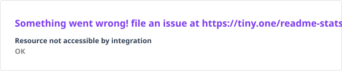

<!-- ============ HEADER ============ -->
<p align="center">
  
</p>

<p align="center">
  <a href="https://github.com/praveenYasas?tab=followers"></a>
  
</p>

<!-- ============ ABOUT ============ -->
## 👨‍💻 About Me

```java
public class PraveenYasas {

    String location          = "Bandaragama, Sri Lanka 🇱🇰";
    String education         = "University of Westminster 🎓";
    String currentlyLearning = "Java ☕";
    String askMeAbout        = "Java";
    String funFact           = "I love playing badminton 🏸";

    String motto() {
        return "Code. Create. Innovate. 🚀";
    }
}
```

<!-- ============ CONNECT ============ -->
## 🤝 Connect With Me

<p align="left">
  <a href="https://www.linkedin.com/in/praveen-yasas-943b6026a/"></a>
  <a href="https://stackoverflow.com/users/22816667/praveen-yasas-2001"></a>
  <a href="https://www.geeksforgeeks.org/user/praveenyaorvh/"></a>
  <a href="https://www.instagram.com/praveen_yasas_/"></a>
  <a href="https://www.facebook.com/praveen.sangarange/"></a>
</p>

<!-- ============ TECH STACK ============ -->
## 🛠️ Tech Stack

<table>
  <tr>
    <td><b>Languages</b></td>
    <td>
      <picture>
        <source media="(prefers-color-scheme: light)" srcset="https://skillicons.dev/icons?i=java,python,js,ts,html,css&theme=light" />
        
      </picture>
    </td>
  </tr>
  <tr>
    <td><b>Frameworks</b></td>
    <td>
      <picture>
        <source media="(prefers-color-scheme: light)" srcset="https://skillicons.dev/icons?i=spring,nodejs,react,flutter&theme=light" />
        
      </picture>
    </td>
  </tr>
  <tr>
    <td><b>Databases &amp; Cloud</b></td>
    <td>
      <picture>
        <source media="(prefers-color-scheme: light)" srcset="https://skillicons.dev/icons?i=mongodb,mysql,firebase,aws&theme=light" />
        
      </picture>
    </td>
  </tr>
  <tr>
    <td><b>Tools</b></td>
    <td>
      <picture>
        <source media="(prefers-color-scheme: light)" srcset="https://skillicons.dev/icons?i=git,github,docker,postman,figma,vscode,discord&theme=light" />
        
      </picture>
    </td>
  </tr>
</table>

<!-- ============ ANALYTICS ============ -->
<!-- All cards below are generated daily by .github/workflows/readme-stats.yml -->
## 📊 GitHub Analytics

<p align="center">
  <picture>
    <source media="(prefers-color-scheme: dark)" srcset="https://raw.githubusercontent.com/PraveenYasas/PraveenYasas/HEAD/profile/stats-dark.svg" />
    
  </picture>
  <picture>
    <source media="(prefers-color-scheme: dark)" srcset="https://raw.githubusercontent.com/PraveenYasas/PraveenYasas/HEAD/profile/top-langs-dark.svg" />
    
  </picture>
</p>

<p align="center">
  <picture>
    <source media="(prefers-color-scheme: dark)" srcset="https://raw.githubusercontent.com/PraveenYasas/PraveenYasas/HEAD/profile/streak-dark.svg" />
    
  </picture>
</p>

<p align="center">
  <picture>
    <source media="(prefers-color-scheme: dark)" srcset="https://raw.githubusercontent.com/PraveenYasas/PraveenYasas/HEAD/profile/snake-dark.svg" />
    
  </picture>
</p>

<!-- ============ FOOTER ============ -->
<p align="center">
  
</p>
